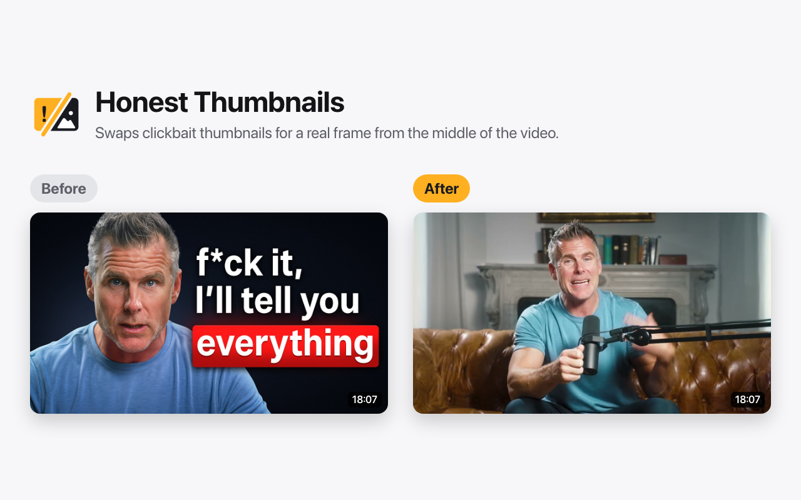
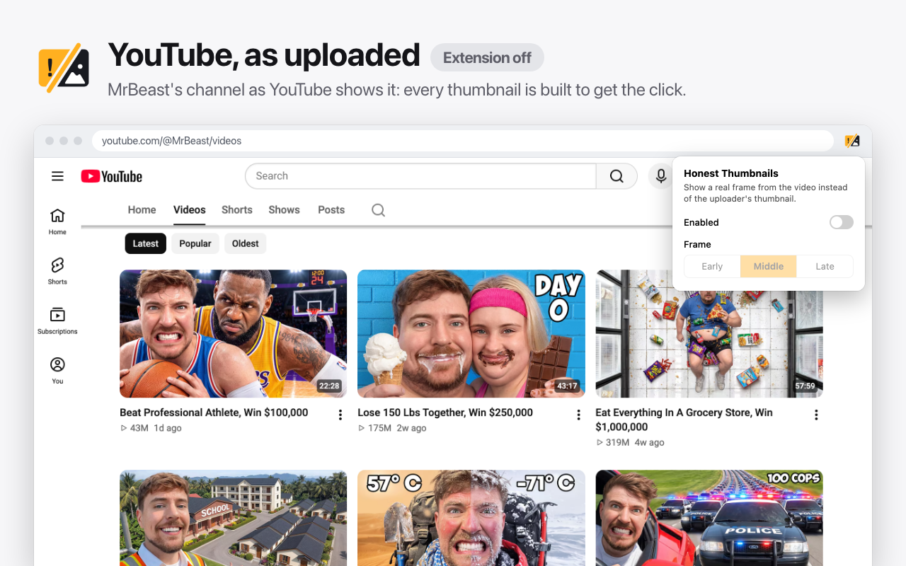
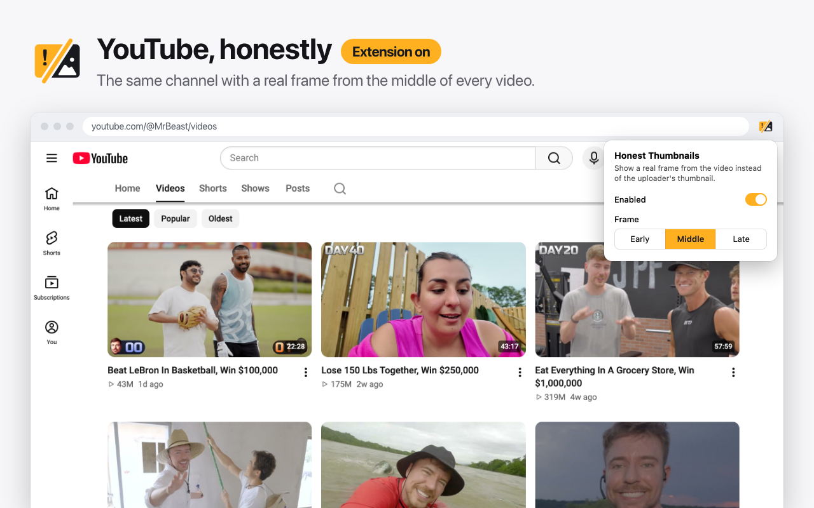

# Honest Thumbnails

**See what's actually in the video, not the clickbait.**

Honest Thumbnails is a Chrome extension that replaces YouTube's uploader-chosen thumbnails with a real frame from the middle of each video.



## Install

- **Chrome Web Store:** in review. The link will be added here once it's live.
- **From source:**
  1. Clone this repo.
  2. Open `chrome://extensions` and turn on **Developer mode**.
  3. Click **Load unpacked** and select the repo folder.

Click the toolbar icon to turn the extension on or off, or to pick an **Early**, **Middle** or **Late** frame.

## What it looks like

The same channel, with the extension off and on:

| Off | On |
| --- | --- |
|  |  |

## How it works

Besides the thumbnail the uploader picks, YouTube automatically saves three stills from every video, roughly a quarter, half and three-quarters of the way through. They live at predictable addresses:

| Image | Size | Availability |
| --- | --- | --- |
| `i.ytimg.com/vi/<id>/maxres1.jpg`, `maxres2.jpg`, `maxres3.jpg` | 1280×720 | HD videos |
| `i.ytimg.com/vi/<id>/hq1.jpg`, `hq2.jpg`, `hq3.jpg` | 480×360 | every video |

Honest Thumbnails finds each thumbnail on the page and swaps it for the chosen frame. It tries the HD version first, falls back to the smaller one, and keeps the original if neither exists. Everything happens in your browser. The idea comes from [HackerTube](https://hackertube.org/), which uses the same mid-video frame.

**It covers:**
- the home feed, search results, channel pages and the watch-page sidebar
- the video player's preview image and the grid of videos shown when a video ends
- embedded players on `youtube.com` and `youtube-nocookie.com`

**Limitations:**
- **It's a fixed point, not a smart pick.** If the middle of a video is a title card, a black screen or a sponsor segment, that's what you'll see. Try the Early or Late frame instead.
- **"Roughly the middle" is approximate.** YouTube doesn't document exactly when these frames are taken.
- **Static videos look the same.** For podcasts with a cover image or music uploads with album art, the frame is the same image as before.

## Privacy

No account, no analytics, no tracking. The extension never sends data anywhere. It only loads images from YouTube's own image server, and it only stores your on/off setting and frame choice. It runs only on YouTube. See [PRIVACY.md](PRIVACY.md).

## Development

There's no build step for the extension itself. Edit the files and click reload on the extension's card in `chrome://extensions`.

```
manifest.json     Manifest V3: storage permission, content script on YouTube
content.js        Finds thumbnails and swaps in YouTube's auto-generated frames
content.css       Crops the letterbox bars on 4:3 frames
popup.html/.js    On/off switch and Early/Middle/Late choice
icons/            Toolbar and store icons (16, 32, 48, 128 px)
store/            Chrome Web Store listing assets (see below)
```

### Store assets

Everything for the Chrome Web Store listing is in `store/` and can be rebuilt from the repo:

- `store/screenshots/*.html`: the screenshots, each a 1280×800 HTML page. Shared styles are in `shared.css` and images in `assets/`. Edit these to change text or layout.
- `store/promo/*.html`: the promo tile. The file name carries the size, e.g. `small-440x280.html`.
- `store/capture.cjs`: loads the extension in headless Chromium and captures `youtube.com/@MrBeast/videos` with the extension off and on, plus the popup in each state. Screenshots 2 and 3 use these captures.
- `store/build.sh`: renders the pages to PNGs with Playwright and packages the extension zip. It needs Node, and the first run downloads Chromium. Nothing is installed into the repo, since the repo folder is also the unpacked extension.

```sh
store/build.sh          # screenshots + promo tile + zip
store/build.sh capture  # re-capture the live YouTube pages (then run `shots`)
store/build.sh shots    # screenshots and promo tile only
store/build.sh zip      # extension zip only
```

To ship an update, bump `version` in `manifest.json`, run `store/build.sh zip`, and upload the zip in the Chrome Web Store dashboard.

## License

[MIT](LICENSE) © 851 Labs
